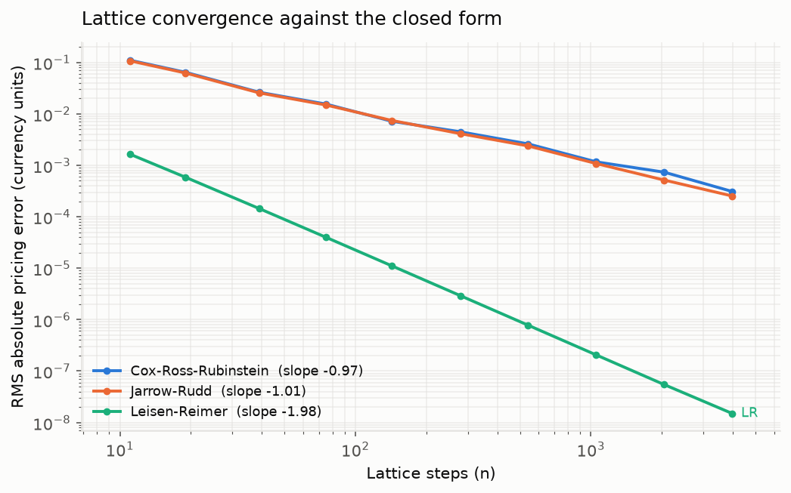
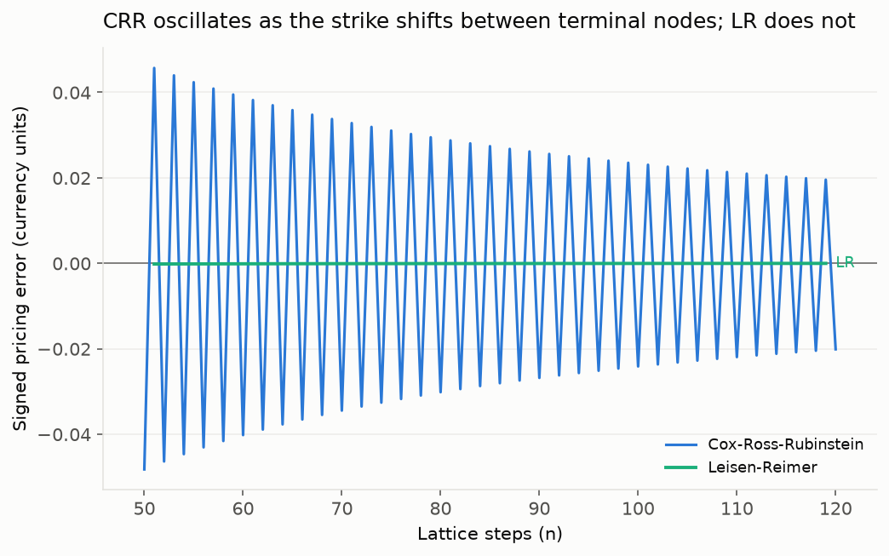
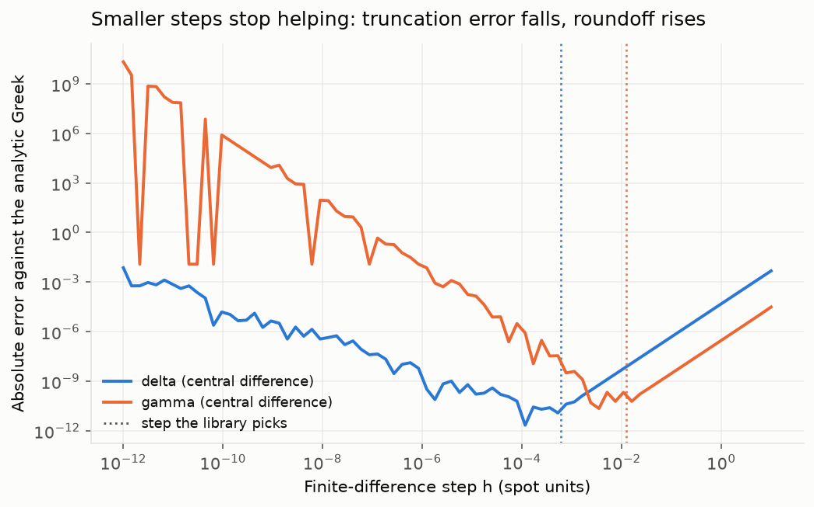
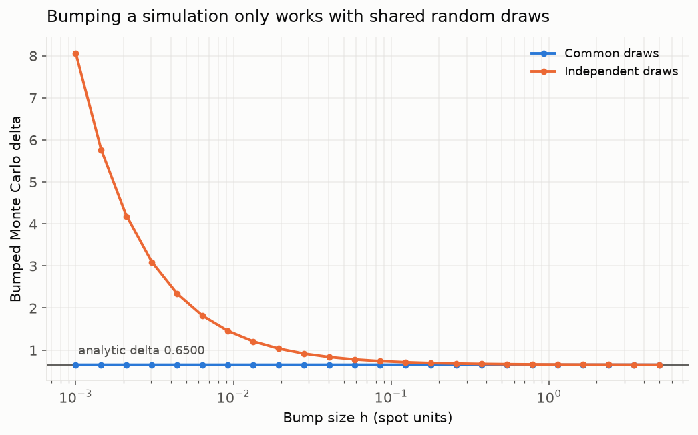
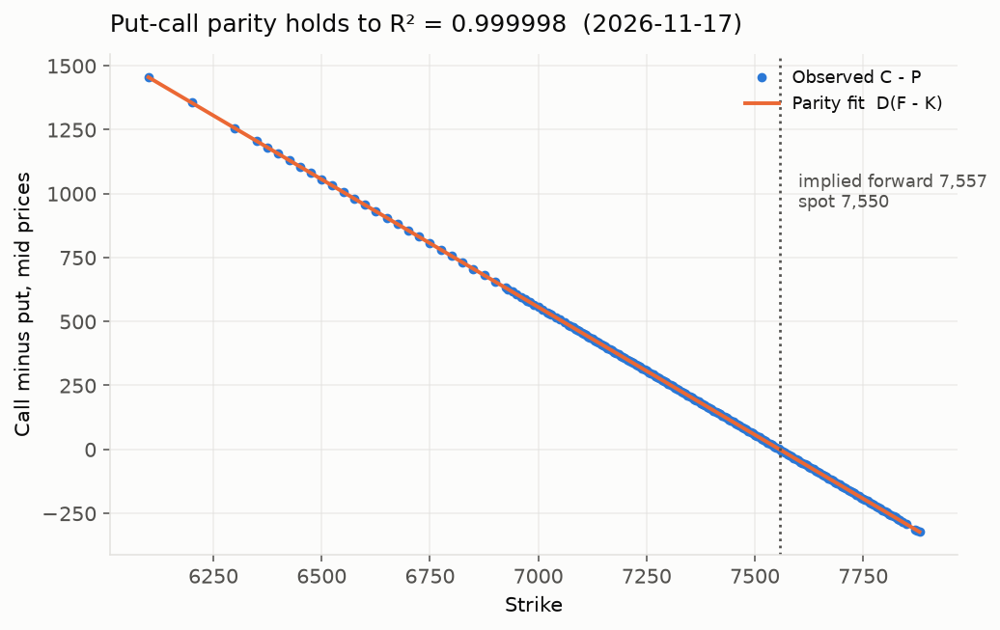
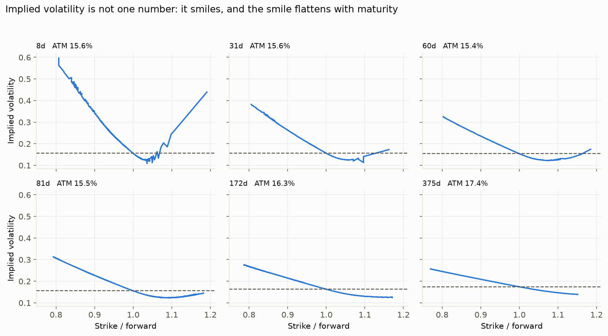
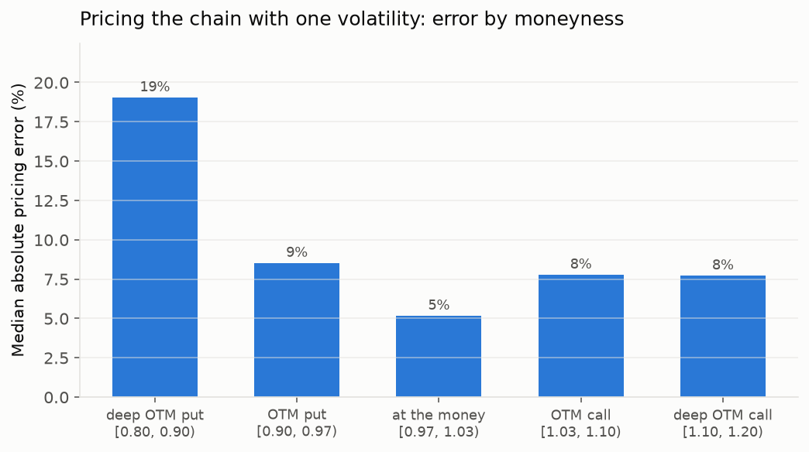

# Option Pricing Engine

Three independent European option pricers, validated against each other and against theory, then pointed at a live SPX chain to measure where the model fails.

**The result in one paragraph.** Black-Scholes, a binomial lattice and a Monte Carlo simulator — built to share no code below a common interface — agree with each other at the convergence rates the mathematics predicts: measured slopes of −0.97, −1.98 and −0.52 against theoretical −1, −2 and −½, with R² between 0.997 and 1.000. Having established the engines are correct, inverting them against 2,260 cleaned SPX quotes shows the model itself is not. A single volatility fits at-the-money prices to within 0.2 volatility points and is wrong by **more than ten points** in the deep put wing. Implied volatility is a smile, not a number, and this repository measures the size of that failure.

---

## 1. The engines agree, at the rate theory says they should


Black-Scholes is exact for European options, so it is the reference. For each approximate engine, the error against it is measured across a sweep of work — lattice steps, or simulated paths — on a grid of six contracts spanning in, at and out of the money at one month and one year. The empirical convergence rate is the OLS slope of log(error) on log(work).

| Method | Theoretical | Measured slope | R² |
| --- | --- | --- | --- |
| Cox-Ross-Rubinstein | O(n⁻¹) | **−0.970** | 0.9972 |
| Jarrow-Rudd | O(n⁻¹) | **−1.010** | 0.9986 |
| Leisen-Reimer | O(n⁻²) | **−1.978** | 1.0000 |
| Monte Carlo | O(n^−½) | **−0.522** | 0.9980 |



Leisen-Reimer is the reason this figure is interesting. It uses Peizer-Pratt inversion to place the strike at the centre of the terminal distribution, and at 4,000 steps it is roughly 3,700× more accurate than Cox-Ross-Rubinstein on identical work.

A log-log plot hides something, though. On a linear axis the standard lattice does not converge smoothly — it oscillates, because as the step count changes the terminal nodes shift relative to the strike and the tree alternates between straddling it well and badly.



Leisen-Reimer is the flat line through the middle. The oscillation is not noise; it is geometry, and it is why averaging adjacent step counts works as a cheap correction.

[`figures/error_vs_time.png`](figures/error_vs_time.png) plots the same comparison against wall-clock seconds rather than step count, which is the form a practitioner actually uses to choose an engine.

---

## 2. Variance reduction, measured per second rather than per path


Antithetic and control variates both lower Monte Carlo variance. The honest question is whether they lower it faster than they cost, so the metric here is efficiency — inversely proportional to variance times run time — not variance alone.

| Technique | Variance reduction | Efficiency gain |
| --- | --- | --- |
| Antithetic | 1.67× | 1.75× |
| Control variate | **6.09×** | **4.25×** |
| Both | 24.40× | 21.38× |

The control variate row is the point of the section. It cuts variance 6.1× and delivers only 4.2×, because computing the control nearly doubles the runtime. A technique that halves variance and doubles cost has gained nothing, and reporting variance alone would have hidden that.

---

## 3. Greeks, three ways


All five Greeks are computed analytically, by central finite difference, and — for delta — by Monte Carlo pathwise differentiation. Analytic and finite-difference agree to between 1.3e-11 and 1.7e-08.

Two numerical facts fall out of this that are easy to state and easy to get wrong.

**A smaller bump is not always more accurate.** Truncation error falls as the step shrinks while floating-point cancellation grows, so total error is U-shaped with an optimum near ε^(1/3) for a first difference and ε^(1/4) for a second.



**Bumping a simulation requires shared random draws.** Price at S+h and S−h with independent draws and the simulation noise, divided by the bump size, destroys the estimate.



At a bump of 0.01 the shared-draw estimate gives 0.6501 against an analytic 0.6500. With independent draws, the same paths and the same seed give **1.4526**.

---

## 4. Where the model breaks


### Data

A dated snapshot of the SPX chain from the CBOE delayed feed, committed to `data/` so every figure regenerates without a network. SPX rather than SPY because SPX options are European and cash-settled on the index — exactly the contract Black-Scholes was written for. SPY options are American on a dividend-paying ETF, and implied volatilities taken from them carry an early-exercise error that cannot be separated out.

Six expiries sampled across the curve from 8 to 375 days, so the surface has a term structure. The cleaning funnel:

| Stage | Quotes |
| --- | --- |
| Raw snapshot | 2,800 |
| Two-sided market (bid > 0) | 2,779 |
| Spread ≤ 20% of mid | 2,711 |
| Moneyness within [0.80, 1.20] | 2,279 |
| Inside no-arbitrage bounds | 2,260 |

Mid prices throughout, never the last trade — on an untraded strike the last print can be hours stale.

### The rate and dividend yield are implied, not assumed

Neither is given in a chain, and fetching them from elsewhere risks a mismatch that appears as a fake skew. Both are extracted from the quotes themselves. Put-call parity gives C − P = D(F − K) for European options, so regressing the call-put spread on the strike yields the discount factor as minus the slope and the forward as the intercept over it.



| Expiry | Days | Implied rate | Implied div. yield | Forward | R² |
| --- | --- | --- | --- | --- | --- |
| 2026-11-17 | 8 | 6.05% | 1.89% | 7,556.83 | 0.999998 |
| 2026-12-10 | 31 | 4.40% | 1.31% | 7,569.78 | 0.999999 |
| 2027-01-08 | 60 | 4.85% | 1.07% | 7,596.98 | 0.999999 |
| 2027-01-29 | 81 | 4.72% | 0.88% | 7,614.69 | 1.000000 |
| 2027-04-30 | 172 | 4.69% | 0.87% | 7,687.01 | 0.999998 |
| 2027-11-19 | 375 | 4.92% | 1.02% | 7,858.87 | 1.000000 |

The fit quality doubles as a data-integrity check: a chain that does not produce a near-perfect straight line here has something wrong with it.

### Two solvers, because they fail differently

Brent's method needs only a bracket containing a sign change and cannot diverge. Newton-Raphson uses vega and converges in roughly half the iterations — when it works.

| Solver | Converged | Mean iterations |
| --- | --- | --- |
| Brent | 2,260 / 2,260 | 11.9 |
| Newton-Raphson | 2,215 / 2,260 | 5.1 |

Newton's 45 failures sit at median absolute log-moneyness of 0.151, against 0.059 for its successes. Vega collapses in the wings and the update diverges. Where both converge they agree to 3.3e-11, so the comparison is about robustness, not accuracy.

### The smile



At 8 days, implied volatility runs from 60% at 0.8× forward down to 12% near the money and back up to 44% in the call wing. By 375 days it is a gentle slope from 26% to 14%. The smile is steepest at the short end and flattens monotonically with maturity.

Pricing each expiry with its own at-the-money volatility — the single number Black-Scholes assumes exists — gives:

| Moneyness (K/F) | Quotes | Volatility points vs. at-the-money |
| --- | --- | --- |
| 0.80 – 0.90 | 424 | **+10.5** |
| 0.90 – 0.97 | 596 | +4.5 |
| 0.97 – 1.03 | 610 | +0.2 |
| 1.03 – 1.10 | 407 | −2.8 |
| 1.10 – 1.20 | 181 | −2.9 |



The asymmetry is the equity index skew: the market charges substantially more for downside protection than a lognormal model says it should, and somewhat less for upside.

### Three checks against things this project did not produce

| Check | Quotes | Median | Mean | 95th pct |
| --- | --- | --- | --- | --- |
| Call-implied vs put-implied vol, same strike | 1,122 | **2.3 bp** | 8.3 bp | 32 bp |
| Our implied vol vs CBOE's published vol | 2,240 | **2.9 bp** | 22.6 bp | 100 bp |

The first is model-free: put-call parity says those two volatilities must agree, and they only do if the forward backed out of the parity regression is right. The second compares against an outside party computing the same quantity independently.

Third, the 31-day at-the-money volatility computed here is **15.6%**; CBOE publishes 15.441 for its 30-day index volatility in the same feed — a 16 basis point difference, arrived at from raw bid-ask quotes through this project's own parity regression and Brent solver.

Both tables are written to `analysis/results/cross_checks.csv` by `analysis/volatility_smile.py`.

---

## 5. Scope: what this does not do, and why


- **No stochastic volatility or jump-diffusion.** Heston and Merton exist precisely because of the pattern measured in section 4, and they are the honest next step. Naming them is more useful than half-building one.
- **No exotic payoffs**, with one exception: the geometric Asian, needed as a Monte Carlo control variate.
- **No finite-difference PDE solver.** A fourth engine adds no argument the first three do not already make.
- **No performance work beyond vectorized NumPy.** No Cython, no Rust.
- **Nothing that places a trade.**

## 6. The app


A browser app over the library, in three tabs.

**Scan** fits a curve through each expiry's implied volatilities and lists quotes sitting far off it, with a written reason for each. Two guards keep it honest: an expiry whose smile did not fit is skipped rather than scanned, and a quote is only flagged when the gap exceeds its own bid-ask spread converted into volatility points. It then ranks the candidates by what survives frictions — the package is sell-the-rich, buy-the-neighbours in whatever ratio zeroes out vega and delta, costed with every spread crossed twice. On the committed snapshot the best candidate nets $86 against a $144 gross, so 40% of the gap must close merely to break even.

**Inspect** prices any contract three ways with full Greeks, and shows the rate, dividend yield and forward implied by that expiry's own quotes.

**Arbitrage** runs put-call parity, vertical, butterfly and calendar checks on executable prices. It finds nothing on SPX, which is the expected result and is reported as such.

```bash
pip install -e ".[app]"
streamlit run app/streamlit_app.py
```

Only European, cash-settled index options are supported — SPX, XSP, NDX, RUT, DJX. Equity options are American, which turns put-call parity from an equality into a pair of inequalities and breaks the forward extraction everything else depends on.

## 7. Running it


```bash
pip install -e ".[dev]"
pytest                                   # 159 tests

python analysis/convergence.py           # section 1
python analysis/variance_reduction.py    # section 2
python analysis/greeks_study.py          # section 3
python analysis/volatility_smile.py      # section 4
streamlit run app/streamlit_app.py       # section 6
```

Every figure in this README regenerates from the committed snapshot. Taking a fresh chain needs `pip install -e ".[data]"` and `python analysis/fetch_chain.py`, which must run on a machine with direct internet access.

Results tables are written to `analysis/results/`.

## 8. Limitations


- One snapshot of one underlying on one date. Nothing here speaks to how the surface moves.
- Mid prices are not executable prices. Real transaction costs are at least half the spread.
- Five of the six expiries are PM-settled weeklies (`SPXW`); the 375-day one is an AM-settled monthly (`SPX`). Both European, so the method is unaffected, but settlement conventions differ.
- Time to expiry is measured in calendar days. A trading-day convention would shift short-dated implied vols measurably.
- The 8-day expiry's implied rate of 6.05% is noisy: at T = 0.022 years, small pricing errors annualize into large rate errors.

## 9. References


- Hull, *Options, Futures, and Other Derivatives* — benchmark values and the Black-Scholes-Merton chapter.
- Leisen, D. and Reimer, M. (1996), "Binomial models for option valuation — examining and improving convergence."
- Glasserman, P., *Monte Carlo Methods in Financial Engineering* — variance reduction and pathwise derivatives.

## License


MIT
